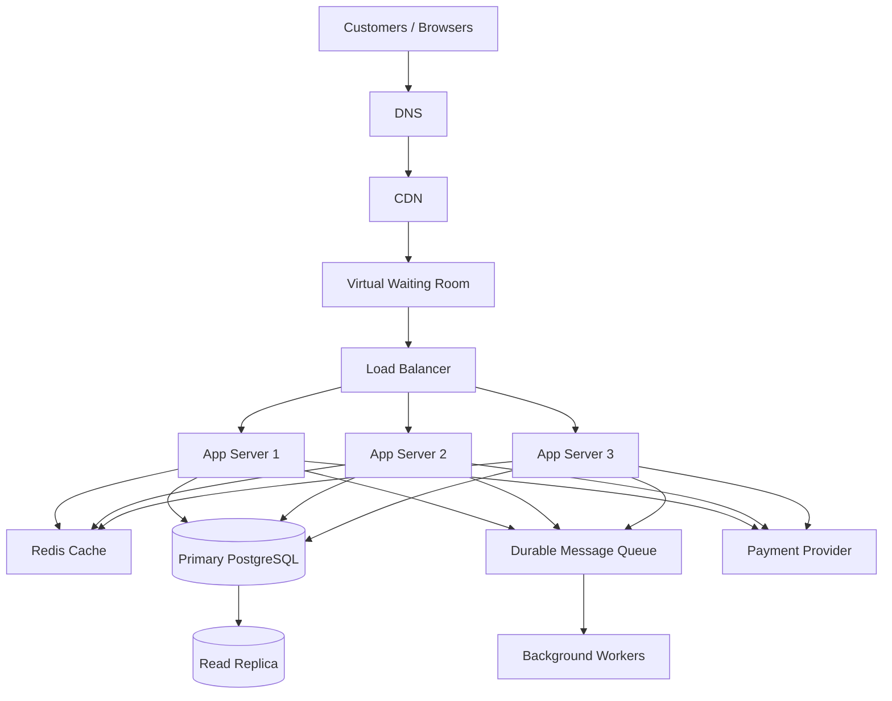

# TicketHub Event Ticketing System Design

## 1. Requirements

TicketHub is an online ticketing platform for concerts and events.

### Functional requirements
1. Users can register, sign in and manage profiles.
2. Users can browse and search upcoming events.
3. Users can view event seats, prices and availability.
4. Users can temporarily hold available seats while completing payment.
5. Users can pay for held seats and create orders.
6. Successful payment permanently assigns seats to the order.
7. Users can view purchased tickets and order history.
8. Expired holds are automatically released.
9. A seat cannot be purchased by two users.
10. Users receive clear success and failure messages.

### Non-functional requirements

**Speed**
- Normal browsing should target p95 latency below 300 ms.
- Seat availability should target p95 below 500 ms.
- Checkout prioritizes correctness while remaining responsive.
- Static content is served through a CDN.

**Correctness**
- A seat must never be sold to two orders.
- Payment and ticket allocation must be consistent.
- Failed and expired holds return seats to inventory.
- The purchase price is recorded at purchase time.

**Fairness**
- A major sale uses a virtual waiting room.
- Rate limiting prevents one client from overwhelming the service.
- Seat holds have a short, clearly communicated expiry period.
- Users cannot bypass the queue by repeatedly refreshing.

**Availability and reliability**
- Target at least 99.9% availability.
- Use multiple application servers and redundant infrastructure.
- Use database replication and backups.
- Health checks remove unhealthy servers.

**Security**
- HTTPS is mandatory.
- Authentication and authorization protect accounts and orders.
- A PCI-compliant payment provider handles sensitive payment data.
- Validation and rate limiting protect APIs from abuse.

---

## 2. Traffic and capacity estimates

Given:
- 2,000,000 registered users.
- 50,000 visitors on a normal day.
- Each visitor views 10 pages.
- 5,000 tickets sold on a normal day.
- A popular concert has 20,000 seats.
- 200,000 people attempt to buy those seats in the first 10 minutes.

### Normal day

Page views:

`50,000 × 10 = 500,000 page views/day`

Average requests per second:

`500,000 / 86,400 ≈ 5.8 requests/second`

Assuming a 10× daily peak:

`5.8 × 10 ≈ 58 requests/second`

Ticket sales average:

`5,000 / 86,400 ≈ 0.058 tickets/second`

That is approximately one ticket sale every 17 seconds.

### Popular concert

Users entering the sale:

`200,000 / 600 ≈ 333 users/second`

If each buyer makes about 10 API requests during the sale:

`200,000 × 10 = 2,000,000 requests`

`2,000,000 / 600 ≈ 3,333 requests/second`

The design should therefore absorb several thousand requests per second, with additional headroom for bursts and retries.

| Metric | Normal day | Popular concert |
|---|---:|---:|
| Visitors/buyers | 50,000/day | 200,000 in 10 min |
| Average activity | ~5.8 req/s | ~333 users/s entering |
| Estimated sale API load | Low | ~3,333 req/s |
| Tickets involved | 5,000/day | 20,000 seats |
| Main challenge | General availability | Extreme burst + seat contention |

The big sale is a concentrated burst rather than simply a larger normal day.

---

## 3. API design

Base URL: `https://api.tickethub.example.com/v1`

| Method | Endpoint | Purpose | Success |
|---|---|---|---|
| GET | `/events` | Browse/search events | 200 OK |
| GET | `/events/{eventId}` | View event details | 200 OK |
| GET | `/events/{eventId}/seats` | View seats and availability | 200 OK |
| POST | `/events/{eventId}/holds` | Temporarily hold seats | 201 Created |
| POST | `/orders` | Create an order | 201 Created |
| POST | `/orders/{orderId}/payment` | Confirm payment | 200 OK |
| GET | `/users/me/tickets` | View purchased tickets | 200 OK |
| DELETE | `/holds/{holdId}` | Release a hold | 204 No Content |

### Hold seats

`POST /v1/events/25/holds`

```json
{
  "seatIds": [1001, 1002, 1003]
}
```

Response:

```json
{
  "holdId": "HLD-83921",
  "eventId": 25,
  "seatIds": [1001, 1002, 1003],
  "expiresAt": "2026-11-01T18:05:00Z"
}
```

If any requested seat is unavailable, return `409 Conflict` and do not partially hold the requested set.

### Create order

`POST /v1/orders`

```json
{
  "holdId": "HLD-83921",
  "paymentMethodToken": "tok_example"
}
```

Response:

```json
{
  "orderId": 70021,
  "status": "PENDING_PAYMENT",
  "total": 15000,
  "currency": "KES"
}
```

API protections:
- Authentication is required for holds, orders and tickets.
- Rate limiting controls abusive traffic.
- Idempotency keys prevent retries from creating duplicate orders.
- `409 Conflict` is returned when inventory has already been claimed.
- Pagination is used for event and ticket lists.

---

## 4. Data model

A relational SQL database such as PostgreSQL is appropriate because ticket inventory requires transactions, constraints and strong consistency.

### Users

| Column | Type | Key |
|---|---|---|
| id | BIGINT | PK |
| email | VARCHAR(255) | UNIQUE, NOT NULL |
| name | VARCHAR(100) | NOT NULL |
| created_at | TIMESTAMP | NOT NULL |

### Events

| Column | Type | Key |
|---|---|---|
| id | BIGINT | PK |
| name | VARCHAR(200) | NOT NULL |
| venue | VARCHAR(200) | NOT NULL |
| starts_at | TIMESTAMP | NOT NULL |
| created_at | TIMESTAMP | NOT NULL |

### Seats

| Column | Type | Key |
|---|---|---|
| id | BIGINT | PK |
| event_id | BIGINT | FK → events.id |
| seat_number | VARCHAR(30) | NOT NULL |
| price | DECIMAL(10,2) | NOT NULL |
| status | VARCHAR(20) | NOT NULL |

Unique `(event_id, seat_number)` prevents duplicate seat records.

### Orders

| Column | Type | Key |
|---|---|---|
| id | BIGINT | PK |
| user_id | BIGINT | FK → users.id |
| status | VARCHAR(30) | NOT NULL |
| total_amount | DECIMAL(10,2) | NOT NULL |
| created_at | TIMESTAMP | NOT NULL |

### Tickets

A fifth table records final seat allocation.

| Column | Type | Key |
|---|---|---|
| id | BIGINT | PK |
| order_id | BIGINT | FK → orders.id |
| seat_id | BIGINT | FK → seats.id |
| event_id | BIGINT | FK → events.id |
| price_paid | DECIMAL(10,2) | NOT NULL |
| issued_at | TIMESTAMP | NOT NULL |

A unique `seat_id` ensures a seat cannot be permanently issued twice.

### Relationships

- `users 1 → many orders`
- `events 1 → many seats`
- `orders 1 → many tickets`
- Each ticket references one seat.
- Each seat belongs to one event.

### CREATE TABLE statements

```sql
CREATE TABLE users (
    id BIGSERIAL PRIMARY KEY,
    email VARCHAR(255) NOT NULL UNIQUE,
    name VARCHAR(100) NOT NULL,
    created_at TIMESTAMP NOT NULL DEFAULT CURRENT_TIMESTAMP
);

CREATE TABLE events (
    id BIGSERIAL PRIMARY KEY,
    name VARCHAR(200) NOT NULL,
    venue VARCHAR(200) NOT NULL,
    starts_at TIMESTAMP NOT NULL,
    created_at TIMESTAMP NOT NULL DEFAULT CURRENT_TIMESTAMP
);

CREATE TABLE seats (
    id BIGSERIAL PRIMARY KEY,
    event_id BIGINT NOT NULL REFERENCES events(id),
    seat_number VARCHAR(30) NOT NULL,
    price DECIMAL(10,2) NOT NULL CHECK (price >= 0),
    status VARCHAR(20) NOT NULL DEFAULT 'AVAILABLE',
    UNIQUE (event_id, seat_number)
);

CREATE TABLE orders (
    id BIGSERIAL PRIMARY KEY,
    user_id BIGINT NOT NULL REFERENCES users(id),
    status VARCHAR(30) NOT NULL,
    total_amount DECIMAL(10,2) NOT NULL CHECK (total_amount >= 0),
    created_at TIMESTAMP NOT NULL DEFAULT CURRENT_TIMESTAMP
);

CREATE TABLE tickets (
    id BIGSERIAL PRIMARY KEY,
    order_id BIGINT NOT NULL REFERENCES orders(id),
    seat_id BIGINT NOT NULL REFERENCES seats(id),
    event_id BIGINT NOT NULL REFERENCES events(id),
    price_paid DECIMAL(10,2) NOT NULL CHECK (price_paid >= 0),
    issued_at TIMESTAMP NOT NULL DEFAULT CURRENT_TIMESTAMP,
    UNIQUE (seat_id)
);

CREATE INDEX idx_seats_event_status ON seats(event_id, status);
CREATE INDEX idx_orders_user ON orders(user_id);
```

---

## 5. Preventing double-booking

The browser must never be trusted to decide whether a seat is available. Two users could see the same seat and submit requests at nearly the same time.

When a user requests seats, the application starts a database transaction and locks the requested rows:

```sql
BEGIN;

SELECT id, status
FROM seats
WHERE id IN (1001, 1002, 1003)
FOR UPDATE;
```

`FOR UPDATE` prevents another transaction from changing those rows until the first transaction completes.

The application verifies that every seat is `AVAILABLE`, then changes them to `HELD`. If every requested seat is successfully held, it commits. Otherwise it rolls back and returns `409 Conflict`.

```sql
UPDATE seats
SET status = 'HELD'
WHERE id IN (1001, 1002, 1003)
  AND status = 'AVAILABLE';
```

The application verifies that the number of updated rows equals the number requested.

### Completing payment

1. Lock the held seats.
2. Verify that the hold belongs to the current user and has not expired.
3. Verify successful payment.
4. Create the order.
5. Create the tickets.
6. Change seats from `HELD` to `SOLD`.
7. Commit the transaction.

The `UNIQUE (seat_id)` constraint on `tickets` provides a second database-level defence.

If User A and User B simultaneously request seat 1001, only one transaction obtains the lock first. The second waits, then sees that the seat is no longer `AVAILABLE` and receives `409 Conflict`.

Therefore, two people cannot successfully purchase the same seat.

---

## 6. Architecture



### Component explanations

| Component | Problem it solves |
|---|---|
| Client | Provides the user interface. |
| DNS | Resolves the public TicketHub address. |
| CDN | Reduces origin traffic by serving static assets close to users. |
| Virtual waiting room | Controls the huge sale burst and improves fairness. |
| Load balancer | Distributes traffic across healthy app servers. |
| App servers | Execute API/business logic and scale horizontally. |
| Redis cache | Reduces repeated reads for popular event data. |
| Primary PostgreSQL | Authoritative transactional store for inventory and orders. |
| Read replica | Handles read-heavy workloads. |
| Message queue | Moves non-critical work away from the purchase path. |
| Workers | Process emails, notifications and analytics asynchronously. |
| Payment provider | Handles sensitive payment processing securely. |

### How the architecture survives the big sale

The 200,000-person sale is controlled first by the virtual waiting room so all users do not hit the seat-allocation database simultaneously. CDN and Redis handle read-heavy traffic. Multiple stateless app servers scale horizontally.

The primary database remains the authority for seat allocation. Seat writes use transactions and row locks rather than relying on cached availability. Rate limiting controls retries and abusive traffic. Email and analytics are moved to the queue so they do not slow checkout.

---

## 7. Trade-offs

### Strong consistency vs performance

Transactions and row locks are slower than relying on cached or eventually consistent inventory. However, a slightly slower purchase is preferable to selling the same seat twice.

**Decision:** cache browsing data, but use strong database transactions for holds and purchases.

### Waiting room vs immediate access

A waiting room adds waiting time and another component, but it prevents 200,000 users from simultaneously competing for 20,000 seats and makes access fairer.

**Decision:** use the waiting room during major sales.

### Read replicas vs consistency

Read replicas increase read capacity but may briefly lag behind the primary.

**Decision:** use replicas for general browsing, but use the primary for inventory-changing operations and critical post-purchase checks.

### Short holds vs customer convenience

Long holds give customers more payment time but block inventory. Very short holds improve turnover but may frustrate users.

**Decision:** use a short, clearly communicated hold period and automatically release expired holds.

